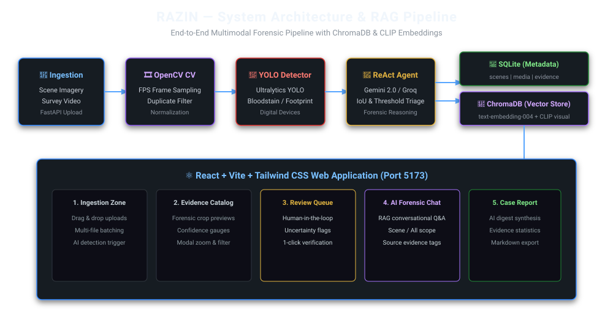
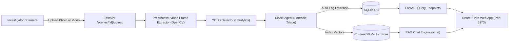
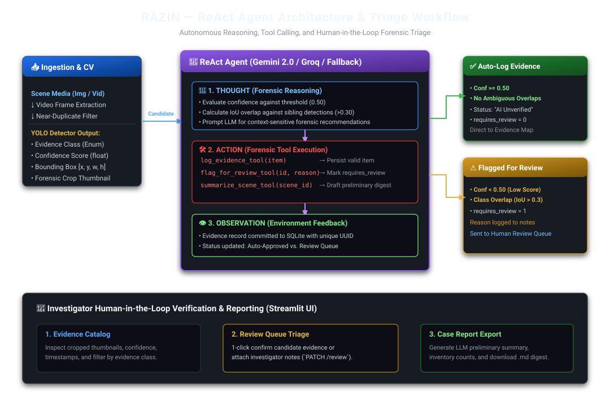
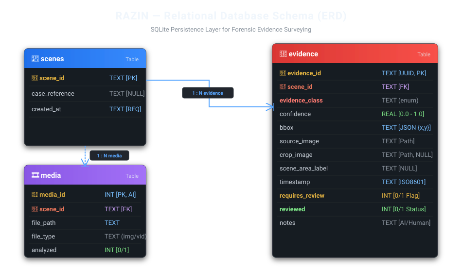

# RAZIN — Forensic Evidence Survey System (v0.1)

AI- and Computer-Vision-assisted preliminary crime-scene evidence surveying system with a modern **React + Vite + Tailwind CSS** web application, a **FastAPI** REST backend, and an **Intelligent Forensic Assistant** powered by **RAG (Retrieval-Augmented Generation)**, **ChromaDB**, and **CLIP Transfer Learning** visual embeddings.

RAZIN empowers forensic investigators by automatically detecting candidate evidence (**bloodstains**, **footprints/shoeprints**, and **digital devices**) from scene photography and video, triaging detections using a **ReAct Agent**, indexing evidence into a vector store for conversational Q&A, and generating preliminary survey digests.

---

## 📐 System Architecture





---

## 🤖 Multimodal RAG Forensic Chatbot

The investigation assistant combines:
1. **ChromaDB Vector Store (`data/chroma/`)**: Persistent, in-process vector database storing evidence metadata and visual features.
2. **Text Embeddings**: Google `text-embedding-004` converts class, confidence, bounding boxes, and forensic notes into searchable semantic vectors.
3. **Transfer Learning Visual Embeddings (CLIP `openai/clip-vit-base-patch32`)**: Pretrained vision transformer generates 512-dimensional visual embeddings directly from evidence crop images, enabling cross-modal visual matching.
4. **Scope Control**: Query evidence scoped to the active scene or across all registered crime cases.
5. **Human-in-the-loop Guardrails**: Explicitly cites source evidence IDs and flags preliminary unverified detections.

---

## 🧠 ReAct Agent Structure & Workflow

The forensic triage agent follows the **ReAct (Reasoning + Acting)** pattern, combining computer vision detections with LLM reasoning (powered by Google Gemini 2.0 Flash or Groq Llama 3.3) and deterministic forensic validation rules.



### Agent Triage Logic:
1. **Thought (Reasoning)**:
   - Evaluates candidate detection confidence against the configured threshold (`CONFIDENCE_THRESHOLD = 0.50`).
   - Calculates Intersection over Union (IoU) overlap against sibling detections in the same image (`IoU > 0.30` between different classes triggers review).
   - Prompts the LLM for context-aware preliminary forensic triage notes.
2. **Action (Forensic Tools)**:
   - `log_evidence_tool`: Persists validated candidate items into the database.
   - `flag_for_review_tool`: Marks items with `requires_review = 1` and attaches detailed reasoning.
   - `summarize_scene_tool`: Synthesizes all logged findings into a preliminary forensic case digest.
   - `index_evidence`: Automatically indexes text & CLIP visual embeddings into ChromaDB upon analysis completion.
3. **Observation**:
   - Confirms persistence with unique UUIDs and updates the scene's digital evidence map.

---

## 🗄️ Database Schema & ERD

RAZIN uses a clean, zero-ORM SQLite architecture with three relational tables: `scenes`, `media`, and `evidence`.



---

## 🚀 Quickstart

### 1. Prerequisites
- Python 3.12+ & `uv` package manager (`pip install uv` or standalone)
- Node.js 18+ & `npm`

### 2. Environment Configuration
Copy the template and configure your API keys:
```bash
cp .env.example .env
```

Edit `.env` to set:
- `LLM_PROVIDER`: `gemini` or `groq`
- `GOOGLE_API_KEY`: Your Google AI Studio API key (used for Gemini LLM + text-embedding-004)
- `GROQ_API_KEY`: Your Groq API key

### 3. Run Locally

Open two terminals:

**Terminal 1: Start FastAPI Backend (Port 8000)**
```bash
uv run main.py api
# Or directly:
uv run uvicorn app.main:app --reload --port 8000
```
- API Base: `http://localhost:8000`
- Interactive API Docs: `http://localhost:8000/docs`
- Health Probe: `http://localhost:8000/health`

**Terminal 2: Start React + Vite Web App (Port 5173)**
```bash
uv run main.py web
# Or directly:
cd frontend && npm run dev
```
- Web App UI: `http://localhost:5173`

---

## 🐳 Run with Docker

```bash
docker compose up --build
```
- React Web App: `http://localhost:5173`
- FastAPI Backend: `http://localhost:8000`

---

## 📁 Project Structure

```
D:\PROJECTS\RAZIN\
├── app/                     # FastAPI Backend
│   ├── __init__.py
│   ├── main.py             # App entrypoint & lifespan
│   ├── config.py           # Settings parser (.env)
│   ├── schemas.py          # Shared Pydantic models
│   ├── db.py               # SQLite persistence & CRUD
│   ├── rag.py              # ChromaDB vector store + CLIP visual embeddings + RAG chat
│   ├── detector.py         # YOLO wrapper, crop generator & visual overlays
│   ├── agent.py            # ReAct agent triage & auto-vector indexing
│   ├── video.py            # Video frame extraction & near-duplicate filter
│   └── routes.py           # REST endpoints (/scenes, /evidence, /chat, /reindex)
├── frontend/                # React + Vite + Tailwind CSS Web Application
│   ├── index.html
│   ├── package.json
│   ├── vite.config.js      # Proxy to backend (:8000)
│   ├── tailwind.config.js  # Forensic dark theme & color tokens
│   ├── src/
│   │   ├── main.jsx
│   │   ├── App.jsx          # Tab navigation & layout
│   │   ├── api/client.js    # Axios API client (includes chat methods)
│   │   ├── context/SceneContext.jsx # Global state
│   │   └── components/
│   │       ├── Navbar.jsx          # Scene manager & metrics
│   │       ├── IngestionZone.jsx   # Drag & drop upload & scanner
│   │       ├── EvidenceGrid.jsx    # Card catalog & filters
│   │       ├── EvidenceModal.jsx   # Zoom & 1-click verification
│   │       ├── ReviewQueue.jsx     # Human-in-the-loop triage
│   │       ├── ChatPanel.jsx       # RAG conversational chatbot UI
│   │       ├── VisualGallery.jsx   # Annotated scene overview
│   │       └── ForensicReport.jsx  # AI digest & Markdown export
│   └── Dockerfile          # Node container
├── assets/                  # SVG Visual assets (ERD, ReAct Workflow, System Arch)
├── data/                    # Runtime media storage, SQLite DB & ChromaDB
├── models/                  # YOLO weights (.pt)
├── test_pipeline.py        # Automated core unit & logic tests
├── test_api.py             # Automated FastAPI + RAG integration tests
├── pyproject.toml          # uv-managed dependencies
├── Dockerfile              # Python API container
├── docker-compose.yml      # Multi-service setup (API + Web)
└── README.md
```

---

## 🧪 Running Automated Tests

```bash
# Core CV & Triage unit tests
uv run python test_pipeline.py

# API integration tests (including RAG chat & ChromaDB indexing)
uv run python test_api.py

# Build frontend production bundle
cd frontend && npm run build
```
