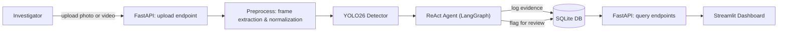

# RAZIN v0.1 — Preliminary Implementation Plan

**Status:** Draft for team review
**Audience:** Written for both human developers and an AI coding agent (e.g. Claude Code, Cursor) scaffolding the repository. Every phase includes enough concrete detail — schemas, endpoints, integration patterns — to work from directly.

---

## Table of Contents
1. [Purpose & How to Use This Document](#1-purpose--how-to-use-this-document)
2. [Executive Summary](#2-executive-summary)
3. [Architecture at a Glance](#3-architecture-at-a-glance)
4. [Phase 1 — Agentic Computer Vision Pipeline (MVP)](#4-phase-1--agentic-computer-vision-pipeline-mvp)
5. [Phase 2 — Live & Robotic Input Integration](#5-phase-2--live--robotic-input-integration)
6. [Phase 3 — Forensic Similarity Analysis & Cross-Scene Analytics](#6-phase-3--forensic-similarity-analysis--cross-scene-analytics)
7. [Phase 4 — Multi-Sensor Fusion & Extended Hardware](#7-phase-4--multi-sensor-fusion--extended-hardware)
8. [Phase 5 — Intelligent Investigation Assistant](#8-phase-5--intelligent-investigation-assistant)
9. [Team Structure](#9-team-structure)
10. [Open Questions, Risks & Recommendations](#10-open-questions-risks--recommendations)

---

## 1. Purpose & How to Use This Document

RAZIN is an AI- and computer-vision-assisted system for preliminary crime-scene evidence surveying. This document lays the project out phase by phase: what each phase builds, and the technology choices and integration pattern for building it.

Phase 1 carries full implementation detail — schemas, endpoints, a Dockerfile, a build order — because it's what gets built first. Phases 2 through 5 describe direction and technology choices at the depth needed to plan for them, without over-specifying work that's still a way off. Where a decision is genuinely still open (an LLM provider, a confidence threshold), it's flagged in Section 10 rather than silently decided, so a coding agent surfaces it to you instead of guessing.

---

## 2. Executive Summary

An investigator uploads photos or video of a scene. A fine-tuned object detector finds candidate evidence — bloodstains, footprints/shoeprints, and digital devices — and a ReAct agent reasons over the raw detections, deciding what to log, what to send to a person for review, and eventually what to summarize. Every record is validated through Pydantic schemas, served through a FastAPI backend, viewed on a Streamlit dashboard, and the whole thing runs in Docker.

Later phases extend the same pipeline outward: a continuous camera or robot feed as an additional input source, transformer-based similarity matching for cross-scene forensic pattern analysis, additional sensor modalities, and a fuller natural-language investigation assistant.

---

## 3. Architecture at a Glance



This is the Phase 1 pipeline. Later phases attach to it rather than replace it: a continuous camera/robot feed joins upstream of **B** (Phase 2), a transformer-based similarity and analytics layer sits alongside **D–F** (Phase 3), additional sensor inputs join alongside **C** (Phase 4), and a conversational assistant layer sits on top of **G–H** (Phase 5).

---

## 4. Phase 1 — Agentic Computer Vision Pipeline (MVP)

### 4.1 Description

Phase 1 is the system's foundation. A person uploads one or more images, or a short video clip, of a scene — real or staged-for-training (see Section 10). If it's video, frames are extracted at a configurable sampling rate. Each frame goes through object detection, producing candidate detections with a class, a bounding box, and a confidence score. Rather than writing these straight to a database, a ReAct agent reviews them first: it decides whether confidence is high enough to log automatically, whether a detection should go to a person for review instead, and — as a stretch goal — produces a short natural-language summary of what was found in a scene. Every logged item carries an explicit "AI-assisted, unverified" status until a person confirms it.

The result is browsable on a dashboard: the uploaded scene, a list of evidence with thumbnails, and a dedicated view for anything flagged for review.

**Explicitly out of scope for this phase:** robot control, live navigation, multi-sensor fusion, and footprint-similarity matching — those arrive in Phases 2 through 4.

### 4.2 Tech Stack & Integration

#### React (ReAct) Agent

*Terminology note: this plan reads "React Agent" as **ReAct** (Reasoning + Acting) — the standard agentic pattern implemented by LangChain/LangGraph — rather than the React.js frontend framework, since everything else in scope here is backend/AI tooling.*

A ReAct agent alternates between **Thought** (reasoning about what to do next), **Action** (calling a tool), and **Observation** (reading the tool's result), looping until it reaches a final decision. That fits this problem well: per image, the agent isn't making one fixed decision, it's making a short sequence of them — is this confident enough to log? does it overlap another detection? does it need a person?

The current standard entry point for this pattern is LangGraph's prebuilt `create_react_agent`, given a model, a list of tools, and a system prompt:

```python
from langgraph.prebuilt import create_react_agent
from langchain.chat_models import init_chat_model
from langchain_core.tools import tool

llm = init_chat_model("<provider-and-model>")  # open decision — see Section 10

RAZIN_AGENT_PROMPT = """
You are RAZIN's forensic evidence triage assistant. You review AI-generated
object detections from crime-scene imagery and decide, per detection,
whether to log it as candidate evidence or flag it for human review.

Rules:
1. Never assert a detection is confirmed evidence — always mark AI output
   as unverified, pending human confirmation.
2. If confidence is below the configured threshold, always flag for review
   rather than logging automatically.
3. If detections of different classes significantly overlap, flag both for
   review rather than silently picking one.
4. When uncertain, prefer flagging over discarding.
"""

@tool
def detect_evidence_tool(image_path: str) -> list[DetectionResult]:
    """Run the fine-tuned YOLO model on an image and return raw detections."""
    ...

@tool
def log_evidence_tool(item: EvidenceItem) -> str:
    """Persist a validated evidence item to the database. Returns the evidence_id."""
    ...

@tool
def flag_for_review_tool(evidence_id: str, reason: str) -> None:
    """Mark an evidence item as requiring human review."""
    ...

agent = create_react_agent(
    model=llm,
    tools=[detect_evidence_tool, log_evidence_tool, flag_for_review_tool],
    prompt=RAZIN_AGENT_PROMPT,
)
```

Exact parameter names on `create_react_agent` shift between LangGraph releases — check the installed version's docs before wiring this up rather than trusting any single snippet, including this one. An optional fourth tool, `summarize_scene_tool`, that turns a scene's logged evidence into a short natural-language summary, is a good stretch goal for later in this phase.

*Since Pydantic is also in scope: PydanticAI, a separate agent framework built by the Pydantic team directly on Pydantic validation, has matured into a real production option. LangChain/LangGraph has the much larger ecosystem and is the default assumed throughout this document, but it's worth a look if a Pydantic-first developer experience ends up mattering more than ecosystem breadth once you're building.*

#### Transformers

Not required for Phase 1's detector itself — YOLO26 is not a pure transformer architecture — but transformers are already in the stack here in a different way: the LLM behind the ReAct agent above is itself a transformer model. If you want a transformer-based *detector* specifically, Ultralytics also supports RT-DETR (Real-Time Detection Transformer) as a drop-in alternative to YOLO; it's worth a benchmark against YOLO26 on your dataset if pushing "transformers" further into this phase matters to you, but it's not necessary for a working MVP.

#### Transfer Learning

Fine-tune a pretrained Ultralytics YOLO26 checkpoint on a small labeled forensic image set covering the three evidence classes:

```python
from ultralytics import YOLO

model = YOLO("yolo26n.pt")  # start from the smallest checkpoint for a fast MVP loop
model.train(data="forensic_dataset.yaml", epochs=100, imgsz=640)
```

YOLO11 remains a reasonable fallback if you want a more battle-tested checkpoint with a longer tutorial trail. For a short sprint, train outside Docker (locally or on a cloud GPU/notebook) and containerize only the exported weights and inference code — GPU passthrough inside Docker is solvable but adds setup overhead that usually isn't worth it until the pipeline itself is working.

#### Computer Vision

Frame extraction from uploaded video via OpenCV at a configurable sampling rate, with basic near-duplicate frame filtering; the YOLO26 detection pass itself; bounding-box and confidence-score handling downstream.

#### Data Analysis

Kept lightweight at this stage: basic evidence counts per class per scene, a confidence-score distribution, and the review-flag rate, computed with pandas and surfaced as a simple summary on the dashboard. This becomes the foundation Phase 3's deeper analytics build on.

#### Supporting Infrastructure

**Data schemas (Pydantic)** — the contract shared by the detector, the agent's tools, the API, and the DB layer:

```python
from pydantic import BaseModel, Field
from datetime import datetime
from enum import Enum
from uuid import UUID, uuid4

class EvidenceClass(str, Enum):
    BLOODSTAIN = "bloodstain"
    FOOTPRINT = "footprint"
    DIGITAL_DEVICE = "digital_device"

class BoundingBox(BaseModel):
    x_min: float
    y_min: float
    x_max: float
    y_max: float

class DetectionResult(BaseModel):
    evidence_class: EvidenceClass
    confidence: float = Field(ge=0.0, le=1.0)
    bbox: BoundingBox

class EvidenceItem(BaseModel):
    evidence_id: UUID = Field(default_factory=uuid4)
    scene_id: str
    evidence_class: EvidenceClass
    confidence: float
    bbox: BoundingBox
    source_image: str
    scene_area_label: str | None = None
    timestamp: datetime = Field(default_factory=datetime.utcnow)
    requires_review: bool = False
    reviewed: bool = False
    notes: str | None = None

class SceneUploadRequest(BaseModel):
    scene_id: str
    case_reference: str | None = None
```

**API layer (FastAPI):**

```python
from fastapi import FastAPI, UploadFile

app = FastAPI(title="RAZIN API", version="0.1.0")

@app.post("/scenes")
def create_scene(request: SceneUploadRequest):
    """Register a new scene/case."""
    ...

@app.post("/scenes/{scene_id}/upload")
async def upload_media(scene_id: str, file: UploadFile):
    """Accept an image or video for a scene; store it and (if video) extract frames."""
    ...

@app.post("/scenes/{scene_id}/analyze")
async def analyze_scene(scene_id: str):
    """Run detection + the ReAct agent over all unanalyzed media for this scene."""
    ...

@app.get("/scenes/{scene_id}/evidence")
def list_evidence(scene_id: str):
    """Return all logged evidence for a scene, including review-flagged items."""
    ...

@app.get("/evidence/{evidence_id}")
def get_evidence(evidence_id: str):
    """Return a single evidence record."""
    ...
```

**Persistence (SQLite, via SQLAlchemy so it's easy to swap for Postgres later):**

```sql
CREATE TABLE scenes (
    scene_id TEXT PRIMARY KEY,
    case_reference TEXT,
    created_at TEXT NOT NULL
);

CREATE TABLE evidence (
    evidence_id TEXT PRIMARY KEY,
    scene_id TEXT NOT NULL REFERENCES scenes(scene_id),
    evidence_class TEXT NOT NULL,
    confidence REAL NOT NULL,
    bbox_x_min REAL, bbox_y_min REAL, bbox_x_max REAL, bbox_y_max REAL,
    source_image TEXT NOT NULL,
    scene_area_label TEXT,
    timestamp TEXT NOT NULL,
    requires_review INTEGER NOT NULL DEFAULT 0,
    reviewed INTEGER NOT NULL DEFAULT 0,
    notes TEXT
);
```

**Dashboard (Streamlit)** — acts purely as an API client (via `httpx`), not a direct DB reader: a scene upload form, an evidence list with thumbnails, and a "needs review" view filtered on `requires_review`.

**Containerization (Docker)** — a `Dockerfile` defines a single reproducible image; `docker-compose.yml` orchestrates it (and, later, any additional services):

```dockerfile
FROM python:3.11-slim

WORKDIR /app

COPY requirements.txt .
RUN pip install --no-cache-dir -r requirements.txt

COPY ./app ./app

EXPOSE 8000

CMD ["uvicorn", "app.main:app", "--host", "0.0.0.0", "--port", "8000"]
```

```yaml
services:
  api:
    build: .
    ports:
      - "8000:8000"
    volumes:
      - ./data:/app/data
    environment:
      - DATABASE_URL=sqlite:///./data/razin.db
```

Mount `./data` as a volume so the SQLite file and uploaded media survive a container restart. Add a `.dockerignore` (excluding `dataset/`, `.venv`, `__pycache__`, `.git`) so the build context stays small.

**Proposed repository structure:**

```
razin/
├── app/
│   ├── main.py                # FastAPI app entrypoint
│   ├── api/
│   │   └── routes.py
│   ├── agents/
│   │   ├── react_agent.py
│   │   └── tools.py
│   ├── cv/
│   │   └── detector.py        # YOLO wrapper
│   ├── models/
│   │   └── schemas.py         # Pydantic models
│   ├── db/
│   │   ├── database.py
│   │   └── crud.py
│   └── dashboard/
│       └── streamlit_app.py
├── dataset/
│   ├── images/
│   └── labels/
├── models/
│   └── yolo_finetuned.pt
├── data/                      # volume-mounted at runtime
├── Dockerfile
├── docker-compose.yml
├── requirements.txt
├── .env.example
├── .dockerignore
└── README.md
```

*(Phase 3 adds an `embeddings/` module alongside `cv/` when the time comes — not needed yet.)*

**Build sequence:** ingestion and persistence must work before the agent is wired in; the agent must work before the dashboard is built.

1. Repo scaffold + Docker skeleton + a FastAPI `/health` endpoint running in a container
2. Define the Pydantic schemas (`app/models/schemas.py`)
3. Set up SQLite + a CRUD layer matching those schemas
4. Wire up `/scenes` and `/scenes/{id}/upload` (store raw files, no AI yet) — prove the ingestion path end-to-end
5. Integrate an off-the-shelf pretrained YOLO checkpoint (no fine-tuning yet) just to prove detect → log works
6. Collect/label a small forensic image set and fine-tune YOLO26 on it
7. Swap in the fine-tuned model
8. Wrap detection as a LangChain tool; build the ReAct agent with the logging and review-flag tools
9. Wire the agent into `/scenes/{id}/analyze`
10. Build the Streamlit dashboard as an API client
11. Full docker-compose integration test, end to end
12. Tag as **RAZIN v0.1**

**Dependencies (`requirements.txt`):**

```
fastapi
uvicorn[standard]
pydantic>=2
langchain
langgraph
langchain-core
ultralytics
torch
opencv-python
streamlit
httpx
sqlalchemy
python-multipart
python-dotenv
```

`.env.example`:
```
DATABASE_URL=sqlite:///./data/razin.db
LLM_PROVIDER=              # e.g. openai, anthropic, ollama — see Section 10
LLM_API_KEY=
```

---

## 5. Phase 2 — Live & Robotic Input Integration

### 5.1 Description

Phase 2 extends ingestion beyond static uploads to a continuous camera feed: a simulated robot (Webots), a real mobile platform, or even just a fixed camera, traversing or observing a scene and feeding frames into the same detection/agent pipeline in near real time, plus basic waypoint navigation. The goal is specifically to plug this in *upstream* of Phase 1 rather than beside it — the detector, the agent, the API, and the database don't change; what changes is where frames come from and how fast they arrive.

### 5.2 Tech Stack & Integration

- **React Agent:** the tool-set grows a capture-worthiness check — should this frame be analyzed at all, or is it a near-duplicate of the last one — plus rate-limiting, so a continuous stream doesn't flood the agent and database with repeated detections of the same object.
- **Transformers:** lightweight transformer-based multi-object tracking (tracking the same detected item across consecutive frames) becomes relevant once you're processing continuous video rather than isolated photos — it's what keeps a single object from being logged as several different pieces of "new" evidence as the camera moves.
- **Transfer Learning:** the same fine-tuned Phase 1 model, validated against frames actually pulled from the camera/robot rig, since lighting, angle, and resolution may differ from the original training set — light additional fine-tuning if there's a systematic gap.
- **Computer Vision:** a real-time inference loop with frame-rate management, integrating with the camera API — Webots' simulated camera device in simulation, or a plain OpenCV `VideoCapture` loop for real hardware.
- **Data Analysis:** mostly operational at this stage — throughput, latency, dropped-frame rate — rather than forensic analysis.
- **Supporting infrastructure:** this is where navigation and localization return, sitting upstream of the Phase 1 FastAPI ingestion layer and publishing frames into it rather than replacing it — Webots for simulation, or ROS2 for real hardware.

---

## 6. Phase 3 — Forensic Similarity Analysis & Cross-Scene Analytics

### 6.1 Description

Phase 3 moves beyond single-image detection into pattern-level forensic analysis: matching footprints or bloodstain patterns against each other across scenes and cases, and surfacing statistical patterns across accumulated evidence — which evidence types tend to co-occur, how confidence trends look over time, whether a footprint at one scene resembles one logged elsewhere. This is the phase where an investigator starts asking "have we seen this before?" rather than just "what's in this photo?"

### 6.2 Tech Stack & Integration

- **React Agent:** two new tools — `find_similar_evidence(evidence_id)`, which queries a vector index, and `compare_scenes(scene_id_a, scene_id_b)`. The agent now orchestrates small analytical workflows, not just per-image triage.
- **Transformers:** this is where they earn a real place in the stack. Run a frozen, pretrained vision transformer over each detected evidence crop to produce a dense embedding. DINOv3, Meta's current self-supervised vision transformer, is a strong default — it needs little to no fine-tuning, ships through the Hugging Face Transformers library, and its patch-level (not just whole-image) features suit comparing local structure well, which is exactly what a footprint tread pattern or a bloodstain spatter shape needs. CLIP is a reasonable alternative if you also want text-to-image search across the evidence database (e.g. "find scenes with a visible laptop").
- **Transfer Learning:** usually unnecessary here since DINOv3 features work well frozen — but a small classifier trained on top of the embeddings is cheap to add later if you accumulate labeled similarity pairs.
- **Computer Vision:** cropping tightly to each detected evidence region before embedding it; a nearest-neighbor index (FAISS, or a brute-force cosine search at this data scale) for the actual matching; optionally, Segment Anything Model 3 (SAM 3) for a precise evidence outline instead of a bounding box, which matters for shape-sensitive analysis like bloodstain directionality.
- **Data Analysis:** the core of this phase — pandas-based aggregation across scenes and cases (evidence-type frequency, confidence trends, co-occurrence patterns), surfaced as a dedicated analytics view on the dashboard.
- **Supporting infrastructure:** a vector index alongside the existing SQLite database — either a dedicated library (FAISS) embedded in the API process, or, at MVP scale, embeddings stored as BLOBs in SQLite with a linear scan.

---

## 7. Phase 4 — Multi-Sensor Fusion & Extended Hardware

### 7.1 Description

Phase 4 combines the RGB pipeline from earlier phases with additional sensor modalities — thermal imaging, LiDAR depth, IMU — for more robust detection under difficult conditions such as low light or partially obscured evidence.

### 7.2 Tech Stack & Integration

This phase is largely hardware integration and sits mostly outside the five technology areas otherwise in scope here — noted for completeness rather than given the same depth as the phases above. The one area that's directly relevant is **Computer Vision**: multi-modal fusion typically means either *late fusion* (running separate detectors per modality and combining their outputs) or *early fusion* (a model trained on stacked, aligned multi-channel input). Late fusion is the more realistic starting point, since Phase 1's detector is already RGB-only and doesn't need to change. React Agent, Transformers, Transfer Learning, and Data Analysis mostly reuse what Phases 1–3 already built rather than introducing new work.

---

## 8. Phase 5 — Intelligent Investigation Assistant

### 8.1 Description

Phase 5 matures the ReAct agent into a full investigation assistant an investigator can talk to directly: asking natural-language questions across cases ("show me all high-confidence bloodstain evidence from case X"), getting an automatically drafted case summary, and, eventually, integration with a finished physical robotic platform.

### 8.2 Tech Stack & Integration

- **React Agent:** the agent's full maturation — likely a small multi-agent setup (e.g. a retrieval-focused sub-agent and a report-drafting sub-agent under a supervisor), with a conversational interface rather than the fixed per-image triage flow from Phase 1.
- **Transformers:** central twice over — the LLM driving the assistant is itself a transformer model, and retrieval-augmented generation over the evidence database, using the same embeddings built in Phase 3, lets it ground answers in actual logged evidence rather than just conversation history.
- **Transfer Learning:** mostly inherited from earlier phases; nothing new to train unless you fine-tune the assistant's report style on real investigator feedback later.
- **Computer Vision:** consumes the accumulated outputs of every earlier phase as context — this phase is about reasoning over CV results, not producing new ones.
- **Data Analysis:** heavily central — statistical summaries, cross-case correlation, and report generation are most of what this phase does.
- **Supporting infrastructure:** the physical robotic platform comes together here, and a move from SQLite to Postgres is worth revisiting given a larger, longer-lived dataset.

---

## 9. Team Structure

- **Member 1 — Backend & Infrastructure:** FastAPI, Docker, database/CRUD layer, repo structure, API design
- **Member 2 — AI/CV & Agents:** dataset prep, YOLO fine-tuning, LangChain/LangGraph agent and tools, Pydantic schemas
- **Together:** integration testing, the Streamlit dashboard, end-to-end pipeline validation

---

## 10. Open Questions, Risks & Recommendations

- **Dataset sourcing & ethics.** For labeled training images of bloodstains, footprints, and digital devices, use staged/simulated training photos or existing public forensic-training image sets rather than real sensitive case photography — both for practical labeling reasons and because real evidentiary images carry privacy, consent, and chain-of-custody handling concerns well beyond an MVP's scope.
- **Confidence threshold policy.** The agent's prompt references a threshold below which detections are auto-flagged rather than logged — pick and document an actual number (e.g. 0.5) as a team decision, not a default buried in code.
- **Framework consistency.** The stack described here — Ultralytics YOLO, Hugging Face Transformers — is PyTorch-native throughout. If a Keras/TensorFlow component is still something you want for its own sake, a clean place for it is a lightweight downstream classifier, kept separate from the core detection/embedding pipeline rather than duplicating it.
- **LLM provider for the agent.** `init_chat_model(...)` needs a real provider. For a fast sprint, a hosted API (OpenAI/Anthropic/etc.) against staged training data is the pragmatic default. For a version that could ever touch real case data, consider a locally-hosted open-weight model (e.g. via Ollama) so scene data never leaves your machine — worth deciding now even if you start with a hosted API for speed.
- **GPU-in-Docker vs. host training.** Training inside a GPU-enabled container is solvable but adds real setup overhead; for a short sprint, train outside Docker and containerize only the exported weights and inference path.
- **Human-in-the-loop framing.** Every AI-generated evidence record should be explicitly marked unverified/AI-assisted until a human confirms it — the agent prompt in Section 4.2 already encodes this, but it's worth keeping as an explicit product principle, not just a prompt detail.
- **Video handling.** Decide a frame-sampling rate and whether to de-duplicate near-identical consecutive frames, so the agent and database aren't flooded with repeat detections of the same object.
- **Minimal auth.** Even at MVP stage, put at least an API key on the FastAPI app — evidence data is sensitive by nature, even when it's staged training data.
